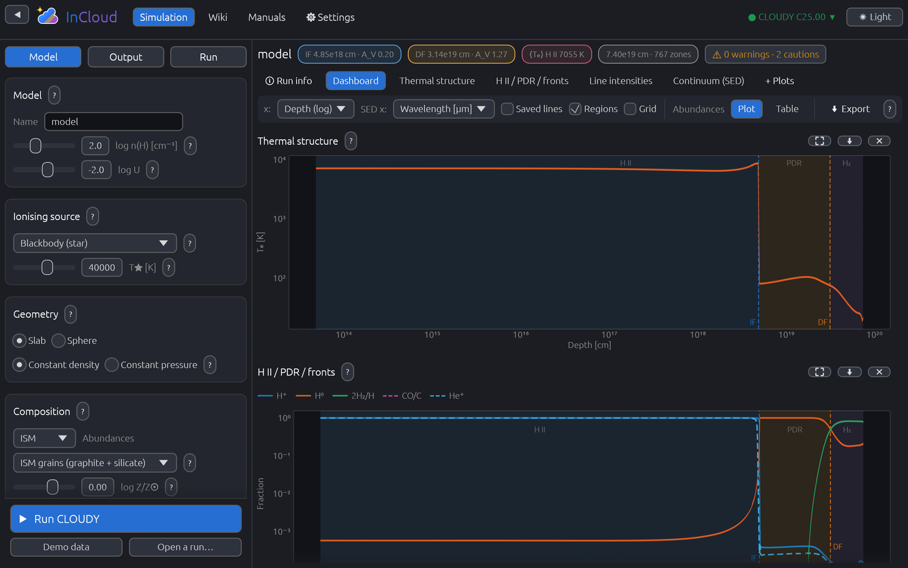
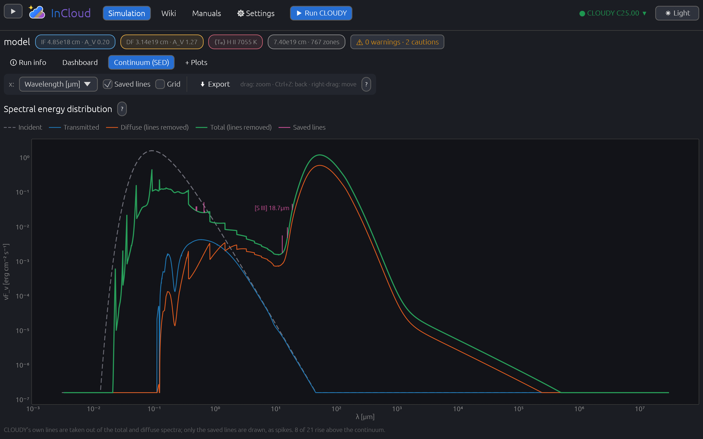
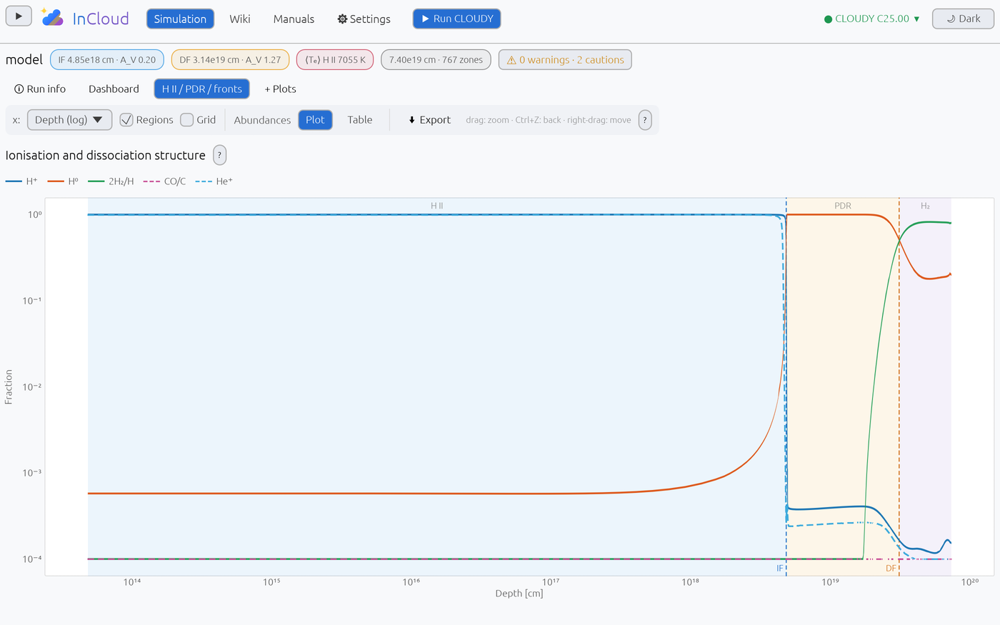
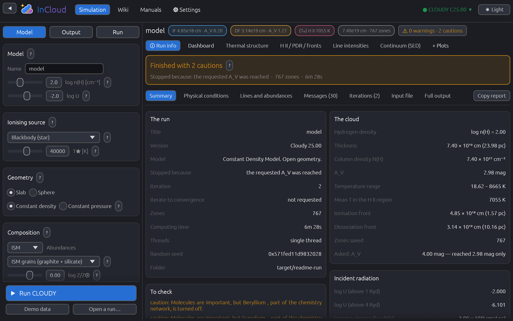
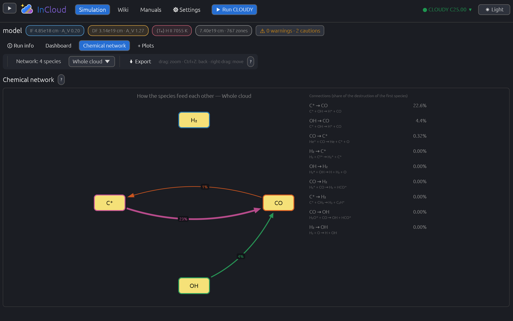
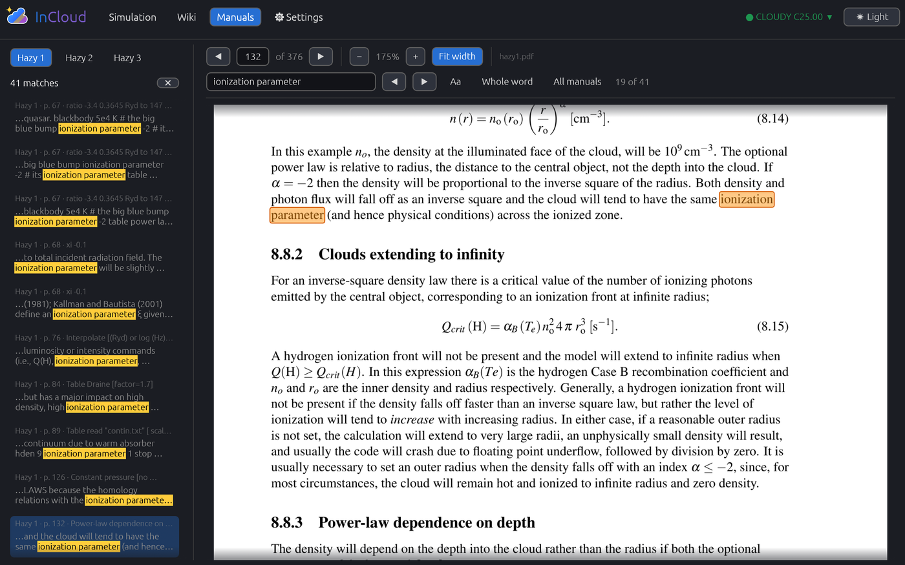
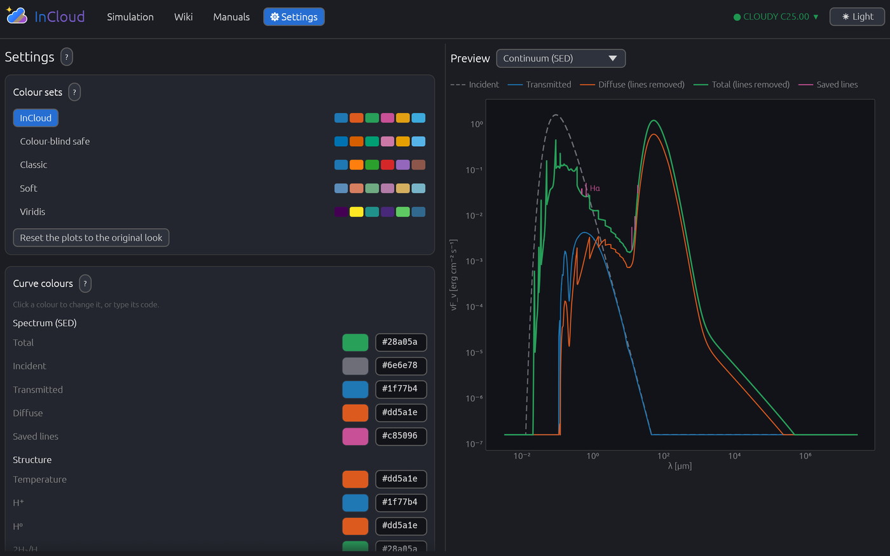
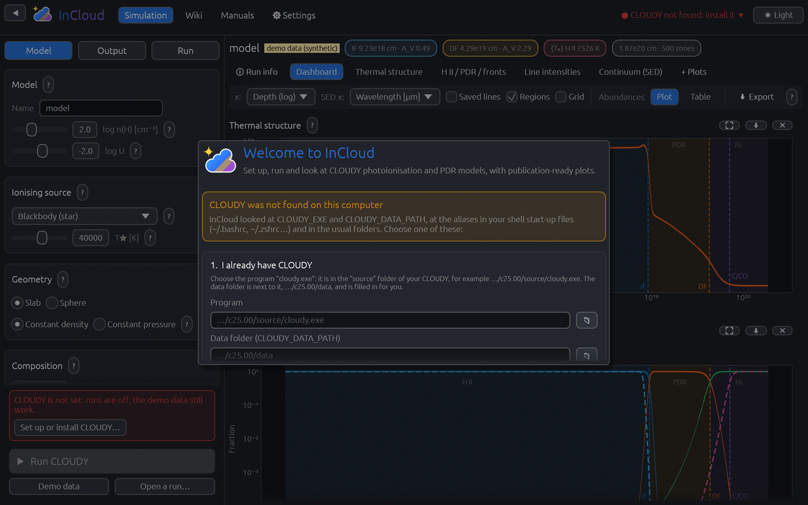

<h1>
  
  InCloud
</h1>

**Set up, run and plot CLOUDY models from one window.**



InCloud is a desktop application to set up, run and explore models made with
[CLOUDY](https://gitlab.nublado.org/cloudy/cloudy), the spectral synthesis code for
photoionised clouds and photodissociation regions (PDRs).

You choose the model with sliders and menus, InCloud writes the CLOUDY input file, runs
CLOUDY and turns its output into clear, publication-ready plots. No input file has to be
written by hand, but you can always see and edit it.

This is a fully open-source project conceived as an educational tool to help users understand
how H II and PDR models work, offering an accessible way to learn CLOUDY. As the application
was developed primarily using [Claude Code](https://claude.com/claude-code) via Craft Anything,
you may encounter some issues: please feel free to open an issue, and it will be addressed as
soon as possible.

This is a fully open-source project conceived as an educational tool to help users understand how HII and PDR models work, offering an accessible way to learn CLOUDY.
As the application was developed primarily using Claude Code via CraftAnything, you may encounter some issues. Please feel free to open an issue, and I will address it as soon as possible.

## Contents

- [What it does](#what-it-does)
- [Screenshots](#screenshots)
- [Installing](#installing)
- [The first start](#the-first-start)
- [Using it](#using-it)
- [Updating](#updating)
- [Where things are kept](#where-things-are-kept)
- [Building from source](#building-from-source)
- [Licence](#licence)

## What it does

- **Model set-up**: hydrogen density, ionisation parameter (or the strength of the
  interstellar field), ionising source (blackbody, AGN, interstellar field, or your own
  spectrum from a file or typed in), slab or sphere, constant density or pressure,
  abundances, grains, metallicity, turbulence, cosmic rays, stopping criteria, iterations or
  *iterate to convergence*.
- **Checks before a run**: InCloud tells you, before starting, when CLOUDY would stop at once
  or end with warnings (for example light so intense that the gas or the grains overheat),
  and fixes what it can by itself.
- **While it runs**: elapsed time, iteration, zone, depth, column density, A_V, temperature
  and the region being computed (H II, PDR, molecular).
- **Plots**: thermal structure, H II / PDR / molecular regions with the ionisation and
  dissociation fronts, ionisation of each element, molecules, line intensities and
  emissivities, where each line forms, line ratios, BPT diagrams (with other runs on the same
  diagram), the spectral energy distribution (with the saved lines on it), grain
  temperatures, heating and cooling, reaction rates and chemical networks, and custom plots
  of any saved quantity. Abundances and reaction rates also as tables.
- **Zoom and export**: every plot opens fitted to its data; drag a rectangle to zoom in, *−*
  (or Ctrl+wheel) to zoom out, *Fit* to see everything again and *Back* to undo; save any plot
  (or just the zoomed area) as PDF, PNG, SVG or CSV, and the data tables as CSV or text.
- **Grids of models**: ranges of any parameter (log U, density, metallicity, column density,
  or any command with a `{placeholder}`), one input file per model and shell scripts that run
  them several at a time, on this computer or on a server (bash or SLURM), shared out over as
  many scripts as you like, with a table of the parameters of every model.
- **Run info**: why the run stopped, whether it converged, physical conditions, energy
  budget, dust, column densities, strongest lines, every iteration and every warning,
  caution and note from CLOUDY, explained in plain words.
- **Wiki and manuals**: a short explanation of every option with links into the CLOUDY
  manuals (Hazy 1, 2, 3), which can be read and searched inside InCloud (Ctrl+F). When a
  CLOUDY has only the LaTeX sources of the manuals, InCloud offers to compile them (and to
  install TinyTeX, without administrator rights, if TeX is missing).
- **CLOUDY versions**: InCloud finds your CLOUDY by itself and can download, compile and
  install the official releases (C17 to C25) for you.
- **Settings**: colours of every curve, ready-made colour sets, plot background (for example
  white plots in the dark theme), fonts and text size of the interface and of the plots, size
  and format of saved figures, light or dark theme, size of the interface.
- **Updates**: InCloud notices new commits on git, or files changed in its source folder, and
  can rebuild itself.

## Screenshots

All pictures show a real CLOUDY C25 model: a 40 000 K star, log n(H) = 2, log U = −2, ISM
abundances and grains.

| | |
| --- | --- |
|  |  |
| **Spectrum**: the total continuum with the saved emission lines standing on it | **Structure**: H II region, PDR and molecular gas, with the ionisation and dissociation fronts |
|  |  |
| **Run info**: why the run stopped, how far it got, cautions explained, physical conditions | **Chemical network**: how the chosen species form and destroy each other |
|  |  |
| **Manuals**: Hazy 1, 2 and 3, searched with Ctrl+F | **Settings**: colours, fonts and backgrounds with a live preview |



*The first start, on a computer without CLOUDY: give its path, let InCloud install it, or look
around with the demo data.*

## Installing

### Linux

You need [Rust](https://rustup.rs) and a C compiler (on Debian/Ubuntu:
`sudo apt install build-essential`). Then, in this folder:

```sh
./install.sh
```

The script builds InCloud, puts it in `~/.local/bin/incloud` and adds it to your application
menu. It offers to install Rust for you if it is missing. Nothing is written outside your home
folder. To remove it: `./install.sh --uninstall`.

### macOS and Windows, or by hand

```sh
cargo build --release
```

and start `target/release/incloud` (`incloud.exe` on Windows).

## Updating

InCloud updates itself from the folder it was built from: **Settings → Updates**.

- If that folder is a git clone, *Check for updates* fetches the new commits and lists them;
  InCloud also looks once at every start (this can be turned off) and shows
  **⬆ Update available** at the top right.
- Files changed in that folder by hand are noticed too.
- *Update now* pulls the commits, builds InCloud again and replaces the program; *Restart
  InCloud* opens the new version. Settings, runs and installed CLOUDY versions are kept.
- At the first start after an update the welcome window says **what's new**: the new notes of
  [CHANGELOG.md](CHANGELOG.md), the new git commits and the files changed. It shows the same
  when opened again from **Settings → Interface**.

From a terminal the same is `./install.sh --update`. Keep the source folder where it is: if it
is moved or deleted, InCloud can no longer update itself and `install.sh` has to be run again
from the new place.

## The first start

InCloud looks for CLOUDY in the `CLOUDY_EXE` and `CLOUDY_DATA_PATH` variables, in the aliases
and exports of your shell start-up files (`~/.bashrc`, `~/.zshrc`, …) and in the usual folders.

- If it finds CLOUDY, it says which version and where, and you can start.
- If not, you can **give the path yourself**: the program is `cloudy.exe` in the `source`
  folder of your CLOUDY (for example `…/c25.00/source/cloudy.exe`) and the data folder is
  next to it (`…/c25.00/data`).
- Or let InCloud **install CLOUDY**: it downloads the official source from nublado.org,
  compiles it and checks it with CLOUDY's own test. This needs a C++ compiler, `make` and
  `perl` (on Debian/Ubuntu: `sudo apt install build-essential perl`) and takes from a few
  minutes to half an hour. Versions go to `~/.local/share/incloud/cloudy` (or to the app's own
  data folder when InCloud runs in a sandbox such as Flatpak), and the folder can be changed.
- Or **skip** and look around with the demo data. Runs stay off until CLOUDY is set; the
  CLOUDY label at the top right is red and opens the set-up when clicked.

You can change version, or install another one, at any time from that label. The welcome
window can be opened again from **Settings → Interface**.

## Using it

1. Set the model in the **Model** tab, choose the lines and plots in **Output**.
2. Press **Run CLOUDY**. Runs go to a temporary folder (deleted when InCloud closes) unless you
   choose a folder in the **Run** tab, where you can also edit the whole input file.
3. Look at the plots, **Run info** and the tables; save what you need with **Export**.

An existing run can be opened with **Open a run…** or from a terminal:

```sh
incloud path/to/run-folder
```

## Where things are kept

| What | Where |
| --- | --- |
| Settings | `~/.config/incloud/settings.txt` |
| CLOUDY versions installed by InCloud | `~/.local/share/incloud/cloudy` (chosen in the CLOUDY versions window) |
| Runs | a temporary folder, or the folder chosen in the **Run** tab |
| Manuals compiled by InCloud | `~/.local/share/incloud/manuals` |

## Building from source

InCloud is written in Rust with [egui](https://github.com/emilk/egui) and
[egui_plot](https://github.com/emilk/egui_plot); saved figures are drawn as SVG and turned into
PNG and PDF with [resvg](https://github.com/linebender/resvg) and
[svg2pdf](https://github.com/typst/svg2pdf); the manuals are rendered with
[hayro](https://github.com/LaurenzV/hayro). `cargo build --release` is all it takes; the
dependencies are downloaded by Cargo.

The code lives in `src/`: `app.rs` (the window), `model.rs` (the parameters and the input
file), `results.rs` and `runinfo.rs` (reading CLOUDY's output), `figures.rs` and `export.rs`
(the plots), `network.rs` (chemical networks), `pdfview.rs` and `pdffind.rs` (the manuals),
`texbuild.rs` (compiling the manuals), `installer.rs` (installing CLOUDY), `batch.rs` (grids of
models), `updater.rs` (updating InCloud) and `wiki.rs` (the wiki). CLOUDY itself is not part of
InCloud: it is a separate program with its own licence, by Gary Ferland and collaborators.

## Licence

This project is released under the [MIT Licence](LICENSE) — feel free to use, modify, and distribute it freely.